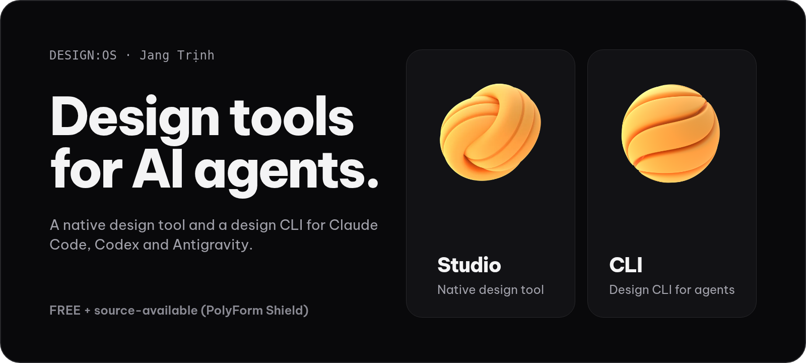

<picture>
  <source media="(prefers-color-scheme: dark)" srcset="assets/profile/hero-dark.png">
  <source media="(prefers-color-scheme: light)" srcset="assets/profile/hero-light.png">
  
</picture>

I'm Jang Trịnh, a designer who builds. DESIGN:OS is my set of design tools for AI coding agents. Studio and the CLI are FREE + source-available ([PolyForm Shield](https://github.com/jangtrinh/design-os-studio/blob/main/LICENSE)).

## Start here

<table>
  <tr>
    <td width="50%" valign="top">
       
      <h3><a href="https://github.com/jangtrinh/design-os-studio">DESIGN:OS Studio</a></h3>
      A native, GPU-accelerated interface design tool built in Rust. It opens and saves <code>.fig</code> files, runs your own coding agent on the open file and ships an MCP server.  
      <a href="https://github.com/jangtrinh/design-os-studio/releases/latest">Download v0.7.10</a> · <a href="https://github.com/jangtrinh/design-os-studio">Repository</a>
    </td>
    <td width="50%" valign="top">
       
      <h3><a href="https://github.com/jangtrinh/design-os">DESIGN:OS CLI</a></h3>
      A design CLI for Claude Code, Codex and Antigravity. Describe the UI in plain words; get web, Figma and SwiftUI output that passes deterministic taste gates.  
      <a href="https://jangtrinh.github.io/design-os/">Docs</a> · <a href="https://github.com/jangtrinh/design-os">Repository</a>
    </td>
  </tr>
</table>

## More from DESIGN:OS

- **[3D Blender](https://github.com/jangtrinh/design-os-3d-blender)**: an agent operating system for Blender 5.2, with a bpy knowledge base and a 3D-print production gate.
- **[Bridge](https://github.com/jangtrinh/design-os-figma-plugin)**: a plugin and CLI that let a shell agent read and edit the Figma file you have open.
- **[SVG Animation](https://github.com/jangtrinh/design-os-svg-animation)**: deterministic vector animation and 1080p 60 fps video for agents.
- **[Code2Flow](https://github.com/jangtrinh/design-os-code2flow)**: turns a Next.js codebase into a user-flow canvas with real screenshots per screen.
- **[Vietnamese](https://github.com/jangtrinh/design-os-vietnamese)**: an offline Vietnamese copy linter plus agent skills.
- **[Robotics](https://github.com/jangtrinh/design-os-robotics)**: procedural robot faces, a 60 fps spring solver and a no-reset health probe for ESP32-S3 voice robots.
- **[Awesome AI Design](https://github.com/jangtrinh/awesome-ai-design)**: a curated list of AI design tools, MCP servers and agent skills, each tagged with price, licence and last-checked date.

All products: [jangtrinh.github.io](https://jangtrinh.github.io/)

## How I work

- **Spec first.** No spec with acceptance criteria, no build.
- **Maker is not the checker.** Work is done when someone else has verified it.
- **Real or absent.** Every screenshot and number is real output, or it is not shown.

## Contact

[jang.work](https://www.jang.work/) · [trinhnguyengiang@gmail.com](mailto:trinhnguyengiang@gmail.com) · [llms.txt](llms.txt)

All public repositories and live docs

| Product | Repository | Live docs |
| :--- | :--- | :--- |
| Studio | [design-os-studio](https://github.com/jangtrinh/design-os-studio) | |
| CLI | [design-os](https://github.com/jangtrinh/design-os) | [jangtrinh.github.io/design-os](https://jangtrinh.github.io/design-os/) |
| Knowledge Builder | [design-os-knowledge-builder](https://github.com/jangtrinh/design-os-knowledge-builder) | [docs](https://jangtrinh.github.io/design-os-knowledge-builder/) |
| Bridge | [design-os-figma-plugin](https://github.com/jangtrinh/design-os-figma-plugin) | [docs](https://jangtrinh.github.io/design-os-figma-plugin/) |
| SVG Animation | [design-os-svg-animation](https://github.com/jangtrinh/design-os-svg-animation) | [docs](https://jangtrinh.github.io/design-os-svg-animation/) |
| 3D Blender | [design-os-3d-blender](https://github.com/jangtrinh/design-os-3d-blender) | [docs](https://jangtrinh.github.io/design-os-3d-blender/) |
| Drone Showcase | [design-os-drone-showcase](https://github.com/jangtrinh/design-os-drone-showcase) | [docs](https://jangtrinh.github.io/design-os-drone-showcase/) |
| GitHub Pages | [design-os-github-page](https://github.com/jangtrinh/design-os-github-page) | [docs](https://jangtrinh.github.io/design-os-github-page/) |
| Apple | [design-os-apple](https://github.com/jangtrinh/design-os-apple) | [docs](https://jangtrinh.github.io/design-os-apple/) |
| Agent Teacher | [design-os-pedagogy](https://github.com/jangtrinh/design-os-pedagogy) | [docs](https://jangtrinh.github.io/design-os-pedagogy/) |
| Voice UX | [design-os-voice-ux](https://github.com/jangtrinh/design-os-voice-ux) | [docs](https://jangtrinh.github.io/design-os-voice-ux/) |
| Code2Flow | [design-os-code2flow](https://github.com/jangtrinh/design-os-code2flow) | [docs](https://jangtrinh.github.io/design-os-code2flow/) |
| Origami | [design-os-origami](https://github.com/jangtrinh/design-os-origami) | [docs](https://jangtrinh.github.io/design-os-origami/) |
| Generative UI | [design-os-generative-ui](https://github.com/jangtrinh/design-os-generative-ui) | [docs](https://jangtrinh.github.io/design-os-generative-ui/) |
| Vietnamese | [design-os-vietnamese](https://github.com/jangtrinh/design-os-vietnamese) | |
| Robotics | [design-os-robotics](https://github.com/jangtrinh/design-os-robotics) | |
| Awesome AI Design | [awesome-ai-design](https://github.com/jangtrinh/awesome-ai-design) | |

